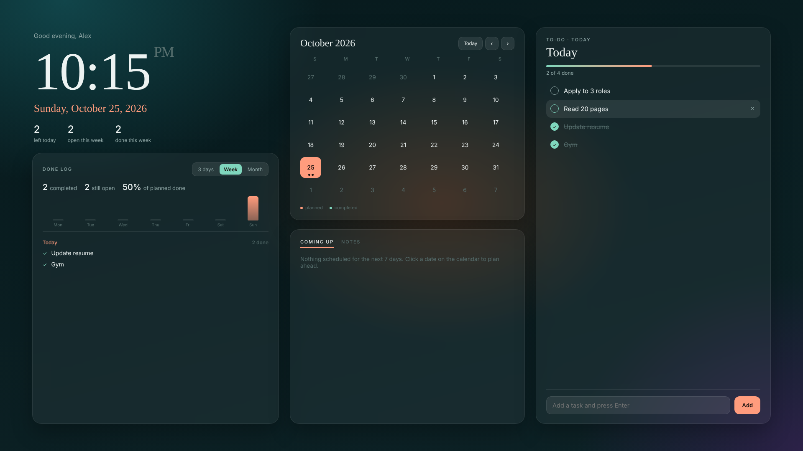

# Desktop Planner

A to-do list, calendar and done log that lives on your desktop wallpaper, so your plan is in front of you every time you minimize a window.

## What's in it

- **Clock and date** with a greeting in your name
- **Monthly calendar.** A coral dot marks days with planned tasks, and a mint dot marks days you completed something.
- **Daily to-do list.** Click any date to plan it. Unfinished tasks from earlier days carry over to today automatically.
- **Done log.** See what you finished and on which date, over the last 3 days, week or month, with a small daily chart and your completion rate.
- **Coming up.** Your next 7 days at a glance.
- **Notes** for anything that isn't a task.

It's a single HTML file with no account, no subscription and no tracking. Everything you type is saved locally on your own computer.

## Setup

First, download `desktop-planner.html` (click the file above, then the download button) and save it in a permanent folder, such as `Documents\Planner`. Don't move or rename it after setup.

### Windows: Lively Wallpaper (free)

1. Install **Lively Wallpaper** from the Microsoft Store.
2. Open Lively, click **+ Add Wallpaper**, and select `desktop-planner.html`.
3. Click it in your library to set it as your wallpaper.
4. In Lively **Settings → Wallpaper**, set wallpaper input to mouse (or keyboard and mouse) so you can click and type on it.
5. Press **Win + D** to see your desktop, type your name, and add your first task.

### Mac: Plash (free)

1. Install **Plash** from the Mac App Store.
2. From the Plash menu bar icon, choose **Add Website** and select `desktop-planner.html`.
3. Turn on **Browsing Mode** when you want to click or type, and turn it off afterward.

### Just want to try it?

Open `desktop-planner.html` in any browser. It works the same way, but tasks you add in the browser are stored separately from the wallpaper version.

## How to use it

| To do this | Do this |
|---|---|
| Add a task | Click a date, type in the box, press Enter |
| Complete a task | Click the circle. It's logged with today's date. |
| Edit a task | Double-click its text |
| Delete a task | Hover over it and click × |
| Move an overdue task to today | Hover over it and click ↻ |
| Change your name | Hover over the greeting and click ✎ |

## Good to know

- Your tasks are saved by the browser or wallpaper app that shows the file. Clearing that app's data clears your tasks.
- If typing doesn't register on the wallpaper, check that keyboard input is turned on in Lively's settings.

## License

MIT. Free to use, change and share.

Built by [Sushant Bhatta](https://www.linkedin.com/in/sushantbhatta7) with Claude.
