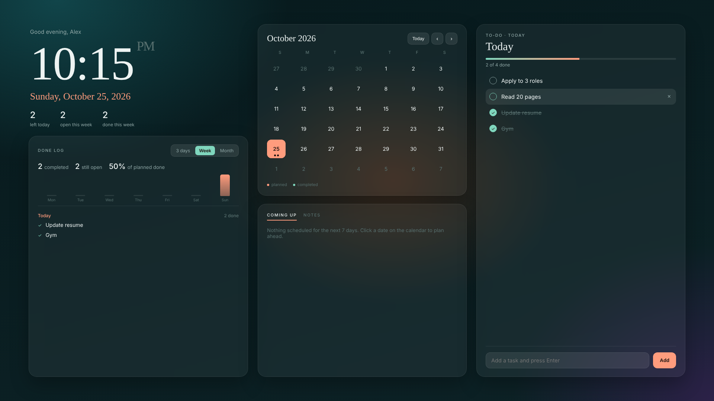

# Desktop Planner

A to-do list, calendar and done log that lives on your desktop wallpaper, so your plan is in front of you every time you minimize a window.

**Try it now:** [sushantdai.github.io/desktop-planner](https://sushantdai.github.io/desktop-planner/) opens the planner in your browser, no download needed.

## What's in it

- **Clock and date** with a greeting in your name
- **Monthly calendar.** A coral dot marks days with planned tasks, and a mint dot marks days you completed something.
- **Daily to-do list.** Click any date to plan it. Unfinished tasks from earlier days carry over to today automatically.
- **Done log.** See what you finished and on which date, over the last 3 days, week or month, with a small daily chart and your completion rate.
- **Coming up.** Your next 7 days at a glance.
- **Notes** for anything that isn't a task.
- **Backup.** Save a copy of everything to a file and restore it any time.

No account, no subscription and no tracking. Everything you type is saved on your own computer.

## Setup

### Option 1: Use it in your browser

1. Open **[sushantdai.github.io/desktop-planner](https://sushantdai.github.io/desktop-planner/)**.
2. Type your name and press Enter.
3. Add your first task.

Bookmark the page or pin the tab. Your tasks stay saved when you come back on the same computer and browser.

### Option 2: Make it your desktop wallpaper

No download needed. You give the wallpaper app the link.

**Windows: Lively Wallpaper (free)**
1. Install **Lively Wallpaper** from the Microsoft Store.
2. Open Lively and click **+ Add Wallpaper**.
3. Paste `https://sushantdai.github.io/desktop-planner/` into the URL box at the top and press Enter.
4. Click it in your library to set it as your wallpaper.
5. In Lively **Settings → Wallpaper**, set wallpaper input to mouse (or keyboard and mouse) so you can click and type on it.
6. Press **Win + D** to see your desktop, type your name, and add your first task.

**Mac: Plash (free)**
1. Install **Plash** from the Mac App Store.
2. From the Plash menu bar icon, choose **Add Website** and paste `https://sushantdai.github.io/desktop-planner/`.
3. Turn on **Browsing Mode** when you want to click or type, and turn it off afterward.

When the planner gets an update, you'll get it automatically, and your tasks stay saved.

### Option 3: Download the file (works offline)

Use this if you want the planner to work without internet, or if adding the link doesn't work in your wallpaper app.

1. Click **desktop-planner.html** in the file list above, then the download button.
2. Save it in a permanent folder, such as `Documents\Planner`. Don't move or rename it after setup.
3. In Lively, click **+ Add Wallpaper** and select the file (or in Plash, choose **Add Website** and select it).

With this option, updates don't arrive automatically. To update, download the new file and follow the backup steps below so you don't lose your tasks.

## How to use it

| To do this | Do this |
|---|---|
| Add a task | Click a date, type in the box, press Enter |
| Complete a task | Click the circle. It's logged with today's date. |
| Edit a task | Double-click its text |
| Delete a task | Hover over it and click × |
| Move an overdue task to today | Hover over it and click ↻ |
| Change your name | Hover over the greeting and click ✎ |

## Saving and backups

Everything saves automatically as you type or tick a task. The **Backup** tab (next to Notes) tells you whether saving is working and when it last saved.

Your tasks are stored by the browser or wallpaper app that shows the planner, on that one computer. So the browser and the wallpaper each keep their own separate list, and you'll start with an empty planner if you:
- use a different computer or browser
- clear your browser data, or reset or reinstall Lively
- add the downloaded file to Lively again, or replace it with a newer version (Option 3)

To keep a safety copy, open **Backup** and click **Download backup** (or **Copy backup** and paste it into Notepad). To bring everything back (tasks, done log and notes), use **Restore from file** or **Restore pasted backup**. This is also how you move your planner to another computer.

If the Backup tab shows a red warning, the app isn't keeping your data. Download a backup before you close it.

## Good to know

- If typing doesn't register on the wallpaper, check that keyboard input is turned on in Lively's settings.

## License

MIT. Free to use, change and share.

Built by [Sushant Bhatta](https://www.linkedin.com/in/sushantbhatta7) with Claude.
